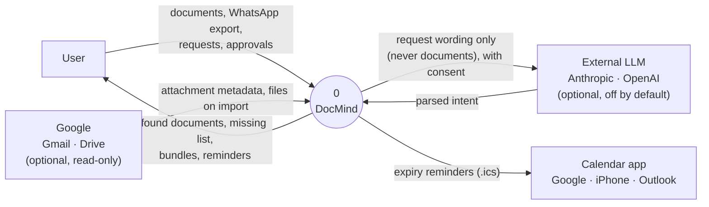
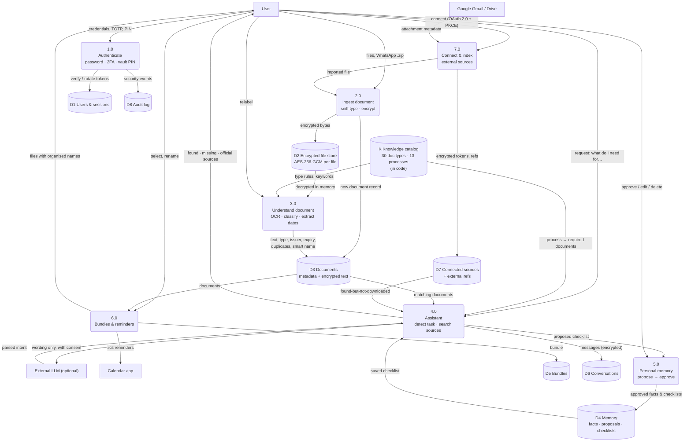
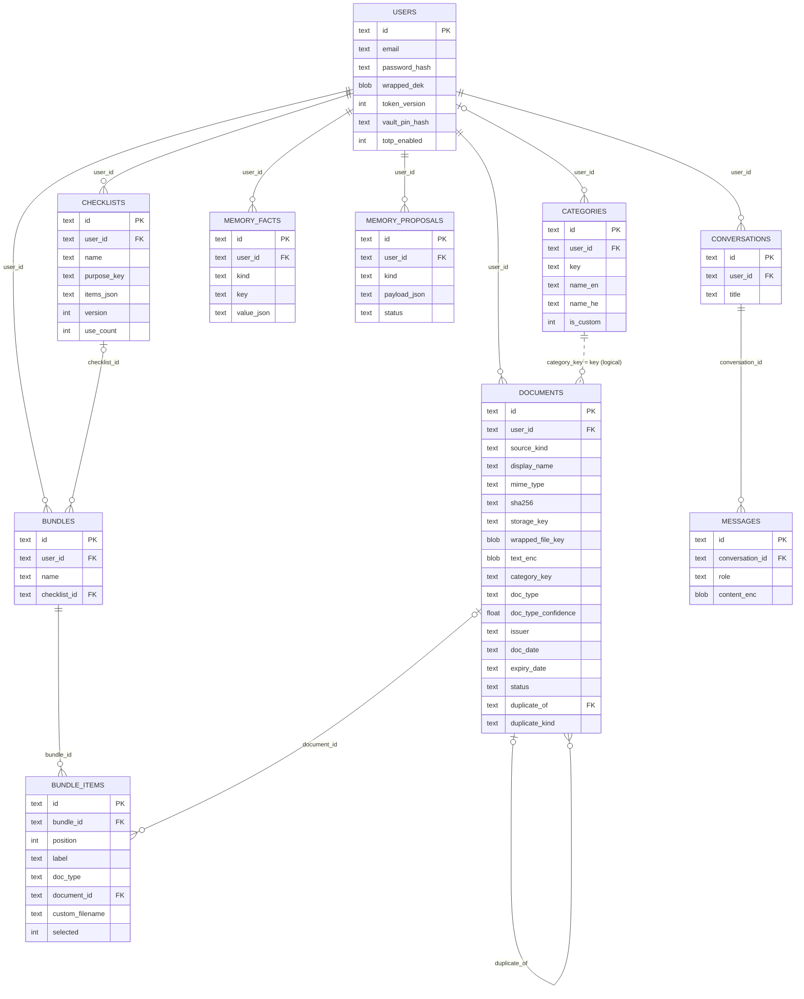
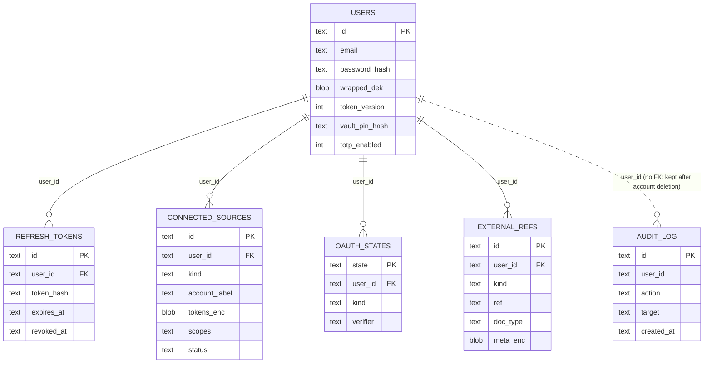
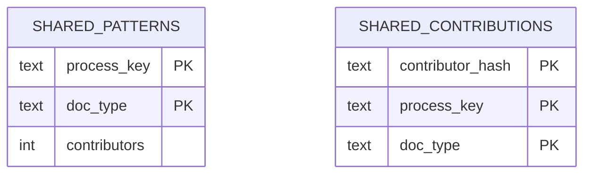

# DocMind: Data Flow & Data Model

Drawn from the code: the SQL migrations in [`backend/docmind/migrations/`](../backend/docmind/migrations/) (the ERD was generated from them, so names match exactly), the services in [`backend/docmind/services/`](../backend/docmind/services/) and the assistant in [`backend/docmind/assistant/`](../backend/docmind/assistant/). These diagrams describe **DocMind Server** (SQLite + an encrypted file store). The phone edition keeps the same kinds of data on the device, in IndexedDB (`docs`, `blobs`, `records`, `kv` stores), encrypted with WebCrypto.

**DFD notation:** rectangles are external entities, numbered rounded boxes are processes, cylinders are data stores.

## DFD Level 0: context diagram

## DFD Level 1

## ERD

DocMind Server stores its data in SQLite. Columns ending in `_enc` and keys named `wrapped_*` hold encrypted data (envelope encryption: a per-user data key, wrapped by the server master key, and a per-file key wrapped by the user's key). Tables are shown with keys and main columns, not every column.

### Documents, memory and the assistant

### Security, sessions and connected sources

`audit_log` has no foreign key on purpose, so the security history survives account deletion.

### Opt-in shared learning (anonymous, disabled by default)

These two tables hold no user ids and no document content: only counts of which document types are needed for which process. `contributor_hash` is a keyed HMAC that cannot be linked back to a user without the server secret.
